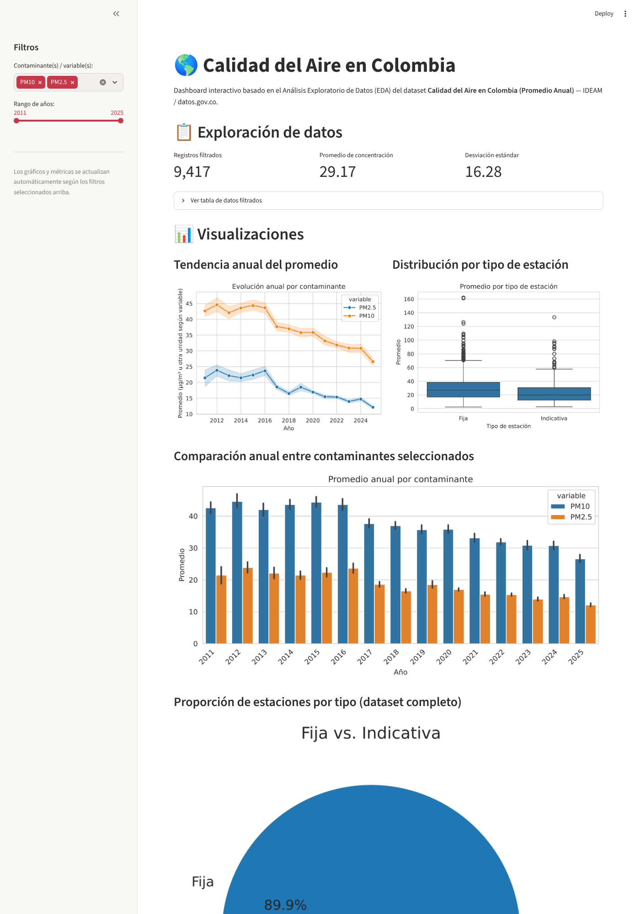

# 🌎 Calidad del Aire en Colombia — Dashboard Interactivo

Dashboard interactivo construido con [Streamlit](https://streamlit.io) que comunica, a una
audiencia no técnica, los resultados del Análisis Exploratorio de Datos (EDA) realizado en
la Tarea 3 sobre el dataset **Calidad del Aire en Colombia (Promedio Anual)** del IDEAM,
disponible en el portal de datos abiertos del Gobierno colombiano (datos.gov.co).

El dashboard permite explorar, filtrar por contaminante y por rango de años, visualizar
tendencias y comparar el comportamiento de PM10 y PM2.5 en el tiempo, además de presentar
en lenguaje sencillo el resultado de la prueba estadística realizada sobre PM2.5 según el
tipo de estación de monitoreo (Fija vs. Indicativa).

Este proyecto es la entrega de la **Tarea 4 — Comunicación de resultados mediante
dashboard interactivo** del curso *Programación para el análisis de datos* (203008069) de
la Universidad Nacional Abierta y a Distancia (UNAD).

## 🔗 Enlaces

- **Dashboard publicado:** [https://calidad-aire-colombia-forero.streamlit.app/](https://calidad-aire-colombia-forero.streamlit.app/)
- **Repositorio:** este mismo repositorio de GitHub

## 📸 Captura de pantalla



## 🔍 Hallazgos principales

- PM10 es el contaminante con más registros en el dataset, seguido de PM2.5.
- Tanto PM10 como PM2.5 muestran una tendencia decreciente sostenida, especialmente marcada desde 2017.
- El promedio de PM2.5 es significativamente más alto en estaciones de tipo Fija que en estaciones de tipo Indicativa (prueba t de Welch, p < 0.05; tamaño del efecto moderado, d de Cohen ≈ 0.38); esto indica una asociación, no necesariamente que el tipo de estación sea la causa de esa diferencia.
- El dataset tiene 668 estaciones de monitoreo **únicas**. De las 667 que tienen el tipo de estación registrado (1 estación no lo tiene), el 64.6% son de tipo Fija (permanentes, 431 estaciones) y el 35.4% son Indicativas (temporales, 236 estaciones).
- La variabilidad entre estaciones es mayor en PM2.5 que en PM10, lo que sugiere una cobertura geográfica más heterogénea para ese contaminante.

## ⚙️ Instalación y ejecución local

1. Clona este repositorio:
   ```bash
   git clone https://github.com/Jhonforero1997/tarea4-calidad-aire-colombia.git
   cd tarea4-calidad-aire-colombia
   ```
2. (Opcional pero recomendado) Crea un entorno virtual:
   ```bash
   python -m venv venv
   source venv/bin/activate  # En Windows: venv\Scripts\activate
   ```
3. Instala las dependencias:
   ```bash
   pip install -r requirements.txt
   ```
4. Ejecuta la aplicación:
   ```bash
   streamlit run app.py
   ```
5. Abre tu navegador en `http://localhost:8501`.

## 🗂️ Estructura del repositorio

```
.
├── app.py                    # Código principal del dashboard
├── kekd-7v7h.csv             # Dataset: Calidad del Aire en Colombia (IDEAM / datos.gov.co)
├── requirements.txt          # Librerías necesarias
├── dashboard_screenshot.png  # Captura de pantalla del dashboard funcionando
└── README.md                 # Este documento
```

## 📚 Fuente de los datos

IDEAM / datos.gov.co. (s.f.). *Calidad del Aire en Colombia (Promedio Anual)* [Conjunto de
datos]. https://www.datos.gov.co/Ambiente-y-Desarrollo-Sostenible/Calidad-del-Aire-en-Colombia-Promedio-Anual-/kekd-7v7h

## 👤 Autor

**Jhon Ivan Forero Forero**
Grupo 31 — Curso: Programación para el análisis de datos (203008069)
Universidad Nacional Abierta y a Distancia (UNAD)
Noviembre de 2026
